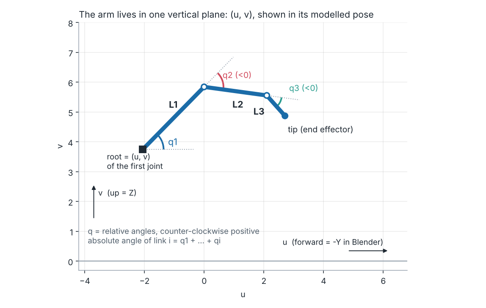
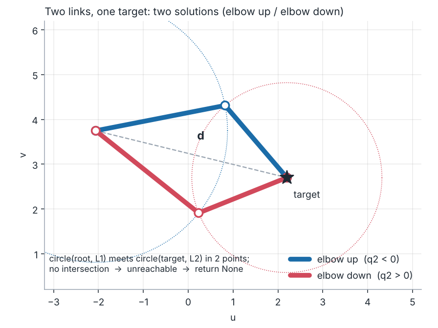
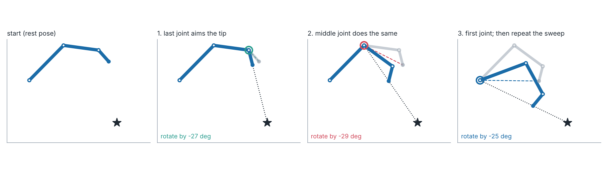

# HW04: Inverse Kinematics from Scratch

**DT475 Animation and Modeling · Blender 5.2 + Python · 10 % · Due: Wed 25 Nov 2026** · Details and background: [README_FULL.md](README_FULL.md)

Write the maths of IK yourself: **three short functions** (about 30 lines) that move the robot arm. Plain Python and `math` only. **Not allowed:** Blender's IK constraint, Damped Track / Track To, `bpy.ops.pose.*`.

## What to do

1. Keep all files in one folder. Open `ik_robotarm_start.blend` → **Scripting** workspace → *Text ▸ Open* `ik_main.py`.
2. Fill in the three `TODO` functions in `ik_main.py` (below). Press **Alt+P** to run; the report is in *Window ▸ Toggle System Console*. It checks your code against the real Blender rig.
3. Try `MODE = "LIVE"` with both `SOLVER = "CCD"` and `"TWO_LINK"`: in **Object Mode**, click `IK_Target`, press **G** and drag it; the arm follows using your code.
4. Copy `answers_template.md` to `answers.md` and answer Q1–Q5, using the numbers printed under **EXPERIMENTS** in `MODE = "CHECK"`.

Edit **only** `ik_main.py`. You do not need to read `ik_helper.py`.

## The arm in 2D

Every point is `(u, v)`: forward and up. `q = [q1, q2, q3]` are **relative** joint angles in **radians**, counter-clockwise positive. The first joint is at `root`; `lengths` are read from the bones.

## Tasks (7.0 points, checked automatically)

| Task | Function | Pts | What it must do |
|---|---|---|---|
| 1 | `forward_kinematics(root, lengths, q)` | 1.5 | Return `[root, …, tip]`. Keep a running angle `a += q[i]`, then move `length·(cos a, sin a)`. Any number of links. |
| 2 | `ik_two_link(root, l1, l2, target, elbow_up)` | 2.0 | Return `(q1, q2)` or `None` if out of reach. Law of cosines; `elbow_up=True` gives `q2 < 0`. |
| 3 | `ik_ccd(root, lengths, q_start, target, limits, max_iter, tol)` | 3.5 | Return `(q, converged)`. Sweep joints tip → root, rotate each toward the target, clamp to `limits`. Don't modify `q_start`. |

## Written answers (2.5 points) and code quality (0.5)

Q1 FK vs IK and number of solutions · Q2 analytic vs CCD · Q3 failure modes (97 % reach, unreachable, what looks odd in LIVE) · Q4 FK, IK or hybrid for five shots · Q5 one algorithm beyond CCD. Short answers in your own words, with numbers from your experiments. Declare any outside help (classmates, tutorials, AI tools) at the top of `answers.md`.

**Optional (+1 bonus):** `ik_challenge.py` — Jacobian transpose and/or FABRIK.

## Submit

One folder named with your **student ID**: `ik_main.py`, `answers.md`, and `ik_challenge.py` if you did it. The same check is used for marking, so you can see your auto score (`Auto-checked points: x / 7.00`) before you submit.

Stuck? See the troubleshooting table in [README_FULL.md](README_FULL.md#9-troubleshooting).
