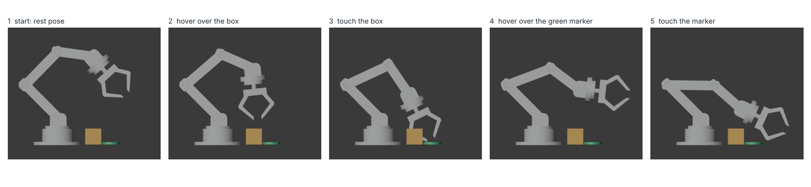
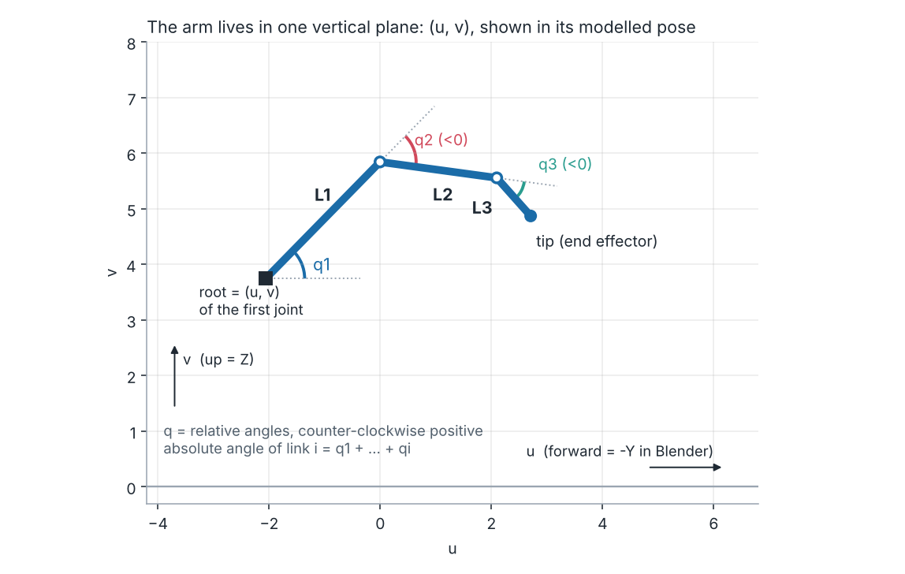
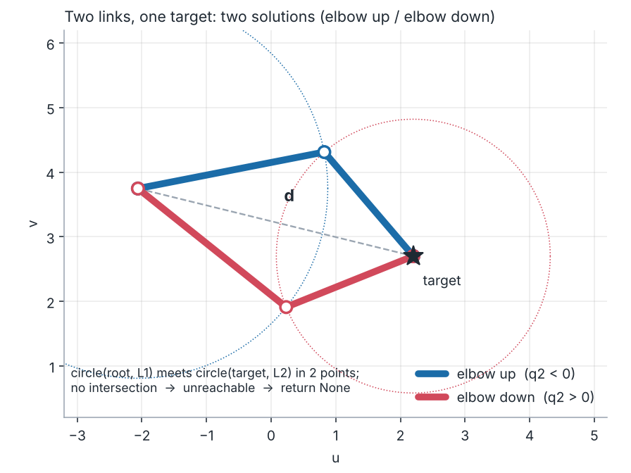
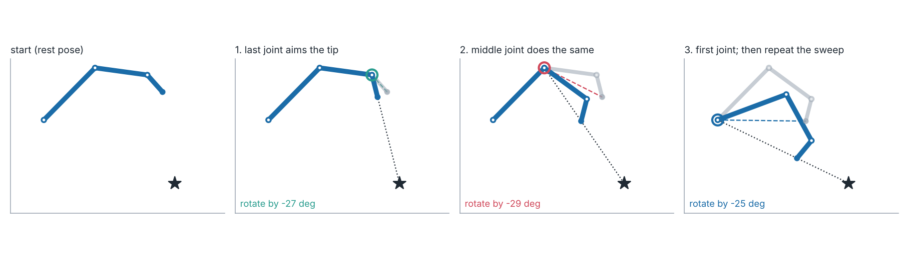

# Assignment: Inverse Kinematics from Scratch (Robot Arm), full version

*Short version: [README.md](README.md).*

**DT475 Animation and Modeling · Blender 5.2 + Python (bpy) · Weight: 10 % · Effort: about 2–3.5 hours outside class** · Due: Wed 25 Nov 2026

Last week you made the robot arm reach with Blender's IK constraint. This week you find out **what that constraint actually does** by writing the maths yourself: **three short functions**, about 30 lines in total. At the end, your own code drags the arm to any target you move, and can play a small demo where the hand visits a box and a green marker.



---

## 1. Learning outcomes

When you finish, you can:

| | Outcome | Where you show it |
|---|---|---|
| **LO1** | **Explain** forward vs inverse kinematics (joint space vs task space), and why IK can have no, one or many solutions. | Written answers Q1 |
| **LO2** | **Implement** planar forward kinematics and **verify** it against Blender. | Task 1 |
| **LO3** | **Derive and implement** closed-form IK for two links (law of cosines). | Task 2 |
| **LO4** | **Implement** an iterative IK solver (CCD) with joint limits, and **evaluate** how it behaves (convergence, unreachable targets, many solutions). | Task 3, Q2–Q3 |
| **LO5** | **Choose** between FK and IK, and between solvers, for a given motion, with evidence. Name other IK algorithms and say what they are good at. | Q4–Q5 |

**Rules.** Plain Python and the `math` module are all you need. **Not allowed:** Blender's IK constraint, Damped Track / Track To to aim bones, `bpy.ops.pose.*`, or anything else in Blender that solves IK for you. Using one of them for a task gives zero for that task. You may discuss ideas with classmates, but write your own code. Declare any outside help (classmates, tutorials, AI tools) at the top of `answers.md`.

---

## 2. Files and how to run

| File | What it is |
|---|---|
| `ik_robotarm_start.blend` | The robot arm from last week (bones + binding), **without** any IK constraint, plus an `IK_Target` empty, a `Box`, a green `Place_Marker`, a floor and a side-view camera. |
| `ik_main.py` | **The only file you edit.** Three functions marked `TODO`. |
| `ik_helper.py` | Blender plumbing (moves the bones, checks your code, live and demo modes). Keep it next to the `.blend`. **You do not need to read or edit it.** |
| `ik_challenge.py` | Optional challenge (+1 bonus), see §5. |
| `answers_template.md` | Copy to `answers.md` and fill in. |
| `images/` | The figures in this worksheet. |

**Run in Blender**

1. Open `ik_robotarm_start.blend` (the `.py` files must be in the same folder).
2. Go to the **Scripting** workspace → *Text ▸ Open* → choose `ik_main.py`.
3. Press **Alt+P** (Run Script). Open *Window ▸ Toggle System Console* to read the report.
4. Fix, **save the file**, run again. Re-running is always safe.

**Run headless (the same check your instructor uses)**

```
C:\blender-5.2.2\blender.exe -b ik_robotarm_start.blend -P ik_main.py
```

The script has three **modes**, set by `MODE` at the top of `ik_main.py`:

| `MODE` | What happens |
|---|---|
| `"CHECK"` (default) | Tests your three functions against the real Blender rig and prints a report (below), then an **EXPERIMENTS** table you use in the written answers. |
| `"LIVE"` | Drag the target: the arm follows using **your** solver. In **Object Mode**, click `IK_Target` in the viewport, press **G** and move it (its X is locked, so it stays in the arm's plane). Set `MODE = "CHECK"` and run again to switch it off. |
| `"DEMO"` | Bakes a short animation (145 frames): the hand visits the box, then the green marker. Press **Space** to play. |

`SOLVER` (`"CCD"` or `"TWO_LINK"`) chooses which of your solvers moves the arm in LIVE and DEMO. With `"TWO_LINK"` the last joint is frozen, so links 2 and 3 act as one longer link. Out-of-reach targets then leave the arm where it is.

Tip: press **Ctrl+Numpad 3** in the 3D viewport for the side view.

The check report compares your functions with Blender's own bones, so *PASS* means your maths really puts the arm in the right place:

```
 [PASS] Task 1a  forward_kinematics vs Blender       1.00 / 1.00
 [TODO] Task 2a  two-link lands on the target        0.00 / 1.00   not implemented yet (ik_two_link)
 ...
 Auto-checked points: 1.50 / 7.00   (written answers + code quality are marked by hand)
```

Work top to bottom. Every unfinished function says `TODO`; nothing crashes while you are still working.

---

## 3. Background

### 3.1 FK and IK

* **Forward kinematics (FK):** you choose the joint angles, the computer tells you where the hand ends up. One answer.
* **Inverse kinematics (IK):** you choose where the hand should be, the computer must find joint angles. There can be **no** answer (too far), **one**, **two** (elbow up / elbow down) or **infinitely many** (more joints than you need).

### 3.2 Our robot, in two dimensions



The arm bends in **one vertical plane**, so every point is just two numbers: **u** (how far forward) and **v** (how high). The base and turret of the robot do not move in this assignment.

| Bone | Role |
|---|---|
| `Bone`, `Bone.001`, `Bone.002` | Base, turret and shoulder link – **fixed** here |
| `Bone.003`, `Bone.004`, `Bone.005` | **The IK chain** – links L1, L2, L3 (the same chain you made with *Chain Length = 3* last week) |
| `Bone.006`, `Bone.007`, `Bone.008` | Wrist and two fingers – they simply follow the chain |

### 3.3 The numbers your functions use

* `root = (u, v)` – position of the first joint of the chain.
* `lengths = [L1, L2, L3]` – link lengths. Never type them in: they are read from the bones.
* `q = [q1, q2, q3]` – **relative** joint angles in **radians**, counter-clockwise positive. `q1` is measured from the +u axis, `q2` from link 1, `q3` from link 2. Link *i* points at the absolute angle `q1 + … + qi`.
* `limits = [(lo, hi), …]` – joint limits in radians, one pair per joint (the file lists them in degrees in `JOINT_LIMITS_DEG`).
* `ik_helper.py` converts these textbook angles to Blender's pose-bone rotations, so you never have to think about bone axes or signs.

---

## 4. Your tasks

All three tasks are functions in `ik_main.py`. **Points** are out of 10.

### Task 1 – Forward kinematics · **1.5 pt** · LO2
Write `forward_kinematics(root, lengths, q)` → list of joint positions `[root, end of L1, end of L2, tip]`.
Keep a running absolute angle: `a += q[i]`; each link adds `length·(cos a, sin a)`. It must work for **any number of links**.

| Part | Points | Check |
|---|---|---|
| 1a | 1.0 | Random poses are set in Blender; your points must match its bones within 0.001 units |
| 1b | 0.5 | Also correct for chains of 2 and 4 links |

### Task 2 – Analytic IK, two links · **2.0 pt** · LO3
Write `ik_two_link(root, l1, l2, target, elbow_up=True)` → `(q1, q2)` or `None`.



1. Let *d* be the distance from the root to the target. The target is reachable only if `|l1 − l2| ≤ d ≤ l1 + l2`; otherwise return `None`.
2. **Law of cosines** gives the elbow angle: `cos q2 = (d² − l1² − l2²) / (2·l1·l2)`. The ± of `acos` gives the two solutions; for an arm reaching forward, **elbow up is the negative `q2`**. (Clamp the cosine into [−1, 1] first.)
3. `q1 = atan2(dy, dx) − atan2(l2·sin q2, l1 + l2·cos q2)`, where `(dx, dy)` = target − root.

| Part | Points | Check |
|---|---|---|
| 2a | 1.0 | Both elbows put Blender's wrist (end of link 2) on the target |
| 2b | 0.5 | `elbow_up=True` gives `q2 < 0`, `False` gives `q2 > 0` |
| 2c | 0.5 | Too far or too close returns `None` |

### Task 3 – Cyclic Coordinate Descent (CCD) · **3.5 pt** · LO4
Write `ik_ccd(root, lengths, q_start, target, limits, max_iter, tol)` → `(q, converged)`.



One **sweep** visits the joints from the **tip towards the root**. For each joint: measure the angle from the joint to the tip and from the joint to the target; rotate the joint by the difference. Recompute the tip after every joint. Repeat sweeps until the tip is within `tol` or you run out of sweeps. *Suggestion: get it working without the clamp first, then add the joint limits.*

| Part | Points | Check |
|---|---|---|
| 3a | 1.5 | Hits ≥ 85 % of 20 reachable targets within 0.01 units |
| 3b | 1.0 | **Clamps** every joint into `limits` (`clamp()` is provided) |
| 3c | 0.5 | **Unreachable targets** do not crash, give NaN, or move the tip farther away |
| 3d | 0.5 | `q_start` is not modified (return a new list); `converged` is `True` only when the tip really is within `tol` |

### Written answers · **2.5 pt** · LO1, LO4, LO5
Copy `answers_template.md` to `answers.md`. The script prints an **EXPERIMENTS** table after the check; use those numbers as evidence. Also try `MODE = "LIVE"` with both solvers, and `MODE = "DEMO"`.

1. **FK vs IK (LO1).** In your own words, define both using *joint space* and *task space*. For each case, say how many IK solutions exist and why: (a) 2 links, reachable; (b) 3 links; (c) a target exactly at full stretch; (d) out of reach. *(Experiments 1 and 3)*
2. **Analytic vs CCD (LO4).** Compare them on exactness, speed (sweeps needed), joint limits, and what kind of chain each works on. Describe what you see in `LIVE` mode with each `SOLVER`. *(Experiment 2)*
3. **Failure modes (LO4).** What happens at 97 % of full reach and for an unreachable target? Look at the gripper while you drag the target in `LIVE` mode with CCD: what looks unnatural, and why do you think CCD does it? What would you do in a production rig?
4. **Pick the method (LO5).** FK, IK or hybrid, with one sentence of reasoning each: (a) the robot waving; (b) pressing a button on a panel; (c) picking up a box; (d) a swinging arm that must keep an elegant arc; (e) the arm moving away after it lets go.
5. **Beyond CCD (LO5).** Choose **one** algorithm from section 7. In 3–5 sentences: how does it differ from CCD, one strength, one weakness, one situation where you would pick it.

Marks per question 0.5: correct reasoning 0.2 · evidence from your own experiments 0.18 · clear, own words 0.12.

---

## 5. Challenge (optional, up to **+1 bonus point**)

Open `ik_challenge.py`. Implement `ik_jacobian_transpose` (**0.5**) and/or `ik_fabrik` (**0.5**), run the file (Alt+P) and it tests them on random reachable targets. Then add a short note to `answers.md`: how many iterations does each need compared with CCD?

---

## 6. Grading (10 points)

| Item | Points | Marked by |
|---|---|---|
| Task 1 FK (1a 1.0 · 1b 0.5) | 1.5 | check report |
| Task 2 two-link analytic (2a 1.0 · 2b 0.5 · 2c 0.5) | 2.0 | check report |
| Task 3 CCD (3a 1.5 · 3b 1.0 · 3c 0.5 · 3d 0.5) | 3.5 | check report |
| Written answers (5 × 0.5) | 2.5 | instructor |
| Code quality and rules (readable, commented, no forbidden Blender IK) | 0.5 | instructor |
| **Total** | **10** | |
| Challenge | +1 | check report |

The check you run is the same one used for marking, so you always know your auto-marked score before you submit. A script that does not run to the end loses the checks it did not reach.

---

## 7. Other IK algorithms worth knowing (read before Q5)

You implemented the two classic starting points. The field is much bigger:

| Algorithm | Core idea | Good at | Watch out for |
|---|---|---|---|
| **Analytic / closed form** (Task 2) | Solve the geometry with trig. | Exact, instant, all solutions at once. | Only for special chains (2 links; 6-axis robot arms with a spherical wrist, Pieper's condition). |
| **CCD** (Task 3) | Rotate one joint at a time toward the target. | Tiny code, no matrices, any chain length, easy joint limits. | Moves the last joints a lot (unnatural poses); can stall against limits; ignores the hand's orientation. |
| **Jacobian transpose / pseudo-inverse / damped least squares** | Linearise: the Jacobian says how the tip moves per joint change; step along it. | Smooth, handles several goals, the standard in robotics. | Needs matrices; the pseudo-inverse blows up near *singularities* (arm fully stretched); damping fixes that but slows convergence. Read: Buss, *Introduction to Inverse Kinematics with Jacobian Transpose, Pseudoinverse and Damped Least Squares methods* (tutorial). |
| **FABRIK** | Move *points*, not angles: pull the chain to the target, then back to the root, repeat. | Fast convergence, natural-looking poses, popular in games and real-time rigs. Aristidou & Lasenby (2011). | Joint limits need extra work; angles are recovered afterwards. |
| **Constraint / optimisation solvers** (e.g. Blender's *iTaSC* option) | Treat IK as "minimise errors of several weighted goals" (position, orientation, limits, comfort). | Many targets and priorities at once. | Heavier, harder to predict, more settings to tune. |
| **Full-body IK** | Several chains + a body: feet planted, hips and spine follow. | Characters that touch the world (feet on stairs, hands on a rail). | Many competing goals; needs good priorities. |
| **Learning-based IK** | A neural network predicts joint angles (or whole poses) from targets. | Very fast at run time; can reproduce a style learned from data (links to our generative-AI topic). | No guarantee of accuracy; only as good as the training data; usually polished by a classic solver. |

Textbook for the analytic side: Craig, *Introduction to Robotics: Mechanics and Control* (chapters on manipulator kinematics).

---

## 8. Submit

Submit **one folder named with your student ID** containing `ik_main.py`, `answers.md`, and (if you did it) `ik_challenge.py`.

## 9. Troubleshooting

| Symptom | Fix |
|---|---|
| `ModuleNotFoundError: ik_helper` | Open the `.blend` from the folder that holds `ik_helper.py`; the script looks for it next to the `.blend`. |
| `[TODO] … not implemented yet` | Normal. That function still raises `NotImplementedError`; replace it with your code. |
| `[FAIL] … crashed: …` | Read the message after *crashed*: it names the Python error (often an index or a typo). |
| Arm tangled or flipped | Print `q` in degrees. A sign error in Task 1 shows up as "FK differs from Blender". |
| Blender freezes | A `while` loop never ended. Use `for _ in range(max_iter)` in CCD. |
| In `LIVE` mode, **G** does nothing | You are in Pose Mode. Switch to **Object Mode**, then click `IK_Target`. |
| Changed `ik_main.py` but nothing changed | Save the text first (**Alt+S**) and run again. |
